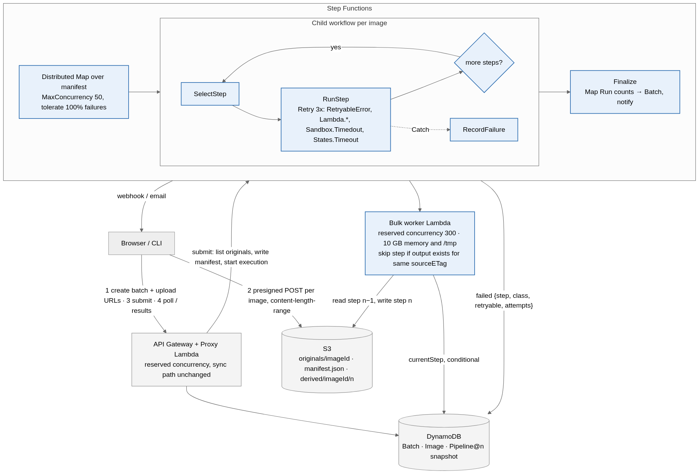
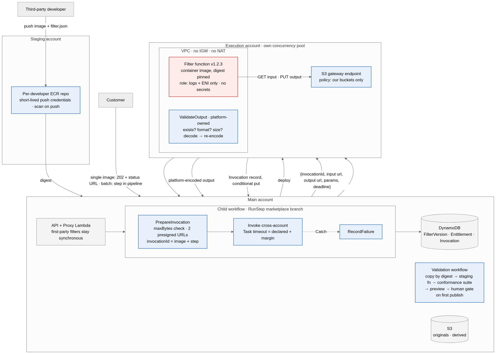

# Aperture prototype

A working build of the architecture in the Aperture assessment submission,
deployed on a personal AWS account and exercised by thirteen experiments.
Scenario A is the bulk image pipeline; Scenario B is the marketplace slice
(third-party filters running in an isolated boundary, with metering).

Everything in this repository was deployed and run. Each claim the submission
makes has an experiment under `experiments/` with the command, the output, and
an explanation. `npm run demo` runs the main path end to end in about 100 s;
the log of the last run is `experiments/demo-run-2026-10-19.log`.

## What it does, in one paragraph

A customer saves a **pipeline** (an ordered list of filters with parameters);
it is validated and stored as an immutable version. They open a **batch**
against that version, upload images **straight to S3** with presigned POST
URLs that carry a size limit, then **submit**. The platform lists what landed,
reconciles it against what was declared, writes a manifest, and starts a
**Step Functions Distributed Map** that runs one **child workflow per image**.
The child loops over the steps: first-party steps run in a worker Lambda;
marketplace steps hand two presigned URLs to a **third-party container in a
VPC with no internet**, then the platform validates and re-encodes what came
back and writes one **metering record**. Every failure is recorded on the
image as `{step, class, retryable, attempts}`; **retry-failed** reruns only
the failed images and **skips steps whose output already exists for the same
original**. The baseline `POST /images` stays synchronous for first-party
filters and returns **202 + status URL** for marketplace ones.

## Architecture

Scenario A (from the submission):



Scenario B:



How the submission's pieces map to code:

| Submission | Code |
| --- | --- |
| A-D1 presigned POST, `content-length-range` | `lambdas/proxy/batches.ts` (`presignUpload`), E1 |
| A-D2 one child workflow per image, `SelectStep → RunStep → Done?` | `lib/pipeline.ts` (JSONata child state machine), `lambdas/worker/run-step.ts` |
| A-D3 pipelines as immutable versions, validated at save | `lambdas/proxy/pipelines.ts`, `lambdas/shared/filters.ts` (`validatePipeline`) |
| A-D4 error taxonomy, `Retry`/`Catch`, `RecordFailure`, checkpoint resume on `sourceETag`, `retry-failed` | `lambdas/shared/errors.ts`, `lambdas/worker/record-failure.ts`, `lambdas/worker/skip.ts`, E3, E5, E6 |
| A-D5 two-phase batch (`open → submitted → running → completed`), reconcile at submit, Map Run counts, SNS | `postSubmit` in `batches.ts`, `lambdas/worker/finalize.ts`, E4 |
| A-D6 reserved concurrency, `MaxConcurrency`, per-org cap | `lib/aperture-prototype-stack.ts` (`CONFIG`), `assertOrgCapacity` in `batches.ts`, E7 |
| B-D1 single-image marketplace request is 202 | `lambdas/proxy/images.ts` (`postImageMarketplace`), E12 |
| B-D2 file-based envelope, `PrepareInvocation`, `ValidateOutput` | `lambdas/marketplace/*.ts`, `filters-3p/pillow-sepia/app.py`, E9, E11 |
| B-D3 isolated execution boundary | `lib/marketplace.ts` (VPC, endpoint policies, filter role), E8 |
| B-D5 metering keyed on (image, step), conditional put | `validate-output.ts` step 4, `record-failure.ts`, E10 |
| B-D6 `allowThirdPartyFilters`, entitlements pinned at admission | `lambdas/proxy/marketplace.ts`, E13 |

Three Lambdas carry image bytes: the Proxy (baseline sync path only), the
worker (`RunStep`), and `ValidateOutput`. Everything else moves metadata and
URLs.

## Experiments

| # | Question | Answer | File |
| --- | --- | --- | --- |
| E1 | Does S3 really enforce the upload size? | 26 MB vs 20 MB policy → `400 EntityTooLarge` from S3; same file via presigned PUT → 200 | [E01](experiments/E01-presigned-post-size-limit.md) |
| E2 | Why can't `POST /images` be the bulk path? | 5.3 MB image as base64 → `413` from API Gateway; 3.2 MB → 200 | [E02](experiments/E02-base64-through-api-limit.md) |
| E3 | Are Lambda timeouts and thrown errors retried alike? | Both: 3 attempts, 2 s / 4 s backoff, same `platform / retryable` record. **E3b**: Retry list without `Sandbox.Timedout` → one attempt, straight to Catch | [E03](experiments/E03-timeout-vs-thrown-error.md) |
| E4 | Declared 5, uploaded 3? | `409 count_mismatch` naming the missing two; `--confirm` runs 3, marks 2 `missing` | [E04](experiments/E04-declared-vs-uploaded.md) |
| E5 | Does retry-failed reuse valid work and recompute stale work? | Retry run = 2 images of 20; step 1 skipped (0.2 s) for same ETag, all steps rerun after re-upload. **E5b**: skip without ETag check → "processed" image built from the old original | [E05](experiments/E05-retry-failed-and-checkpoint-resume.md) |
| E6 | Is `RunStep` idempotent? | Hand re-invoke → `skipped: true, advance: duplicate`, item unchanged | [E06](experiments/E06-duplicate-run-step.md) |
| E7 | Can bulk work starve the API? | Worker capped at 1: throttles retried as `Lambda.TooManyRequestsException`, 4/10 fail retryable; `POST /images` stays 200 at ~1.4 s throughout; retry after restoring → 10/10 | [E07](experiments/E07-reserved-concurrency.md) |
| E8 | What can a hostile filter reach? | Internet: no route. Our bucket list, DynamoDB, other bucket: 403. Filter still produced its image | [E08](experiments/E08-hostile-filter-boundary.md) |
| E9 | Do first-party and marketplace steps mix? | `grayscale → sepia-3p → resize` runs in one child execution; found and fixed a missing `s3:PutObjectTagging` in the endpoint policy | [E09](experiments/E09-mixed-pipeline-end-to-end.md) |
| E10 | Does a step bill once? | Replayed `ValidateOutput` → `metering: duplicate`; error record upgraded to ok exactly once | [E10](experiments/E10-metering-bills-once.md) |
| E11 | What if the filter lies? | "ok" with no output → `failed`, `class: filter`, `billable: false` | [E11](experiments/E11-liar-filter.md) |
| E12 | Single image with a marketplace filter? | `202` + status URL, `processed` in ~3 s warm / ~7 s cold | [E12](experiments/E12-single-image-marketplace-202.md) |
| E13 | Policy and entitlement gates? | Policy off → `403` at pipeline save; no entitlement → `402` at request; terms pinned on the batch | [E13](experiments/E13-policy-and-entitlement.md) |

Each file has a "Teach-back" line left blank for you to fill in after reading.

## Running it

Prerequisites: Node 20+, Docker running (for the Python filter image), an AWS
profile named `personal` for account `163395467013`. All npm scripts force
`AWS_PROFILE=personal`; the stack is pinned to that account in
`bin/aperture-prototype.ts`.

```
npm install
npm run layer:sharp        # once: sharp binaries for linux/arm64
npm run deploy             # ~8 min first time (VPC + container image), ~1.5 min after
npm test                   # 22 unit tests: error taxonomy, skip rule, pipeline validation
npm run demo               # Scenario A + B end to end, ~100 s
```

The CLI (`npm run cli -- <command>`) drives every API route and reads table
and execution state; the command list is at the top of `cli/aperture.ts`.
`trace <imageId>` prints one image's Step Functions timeline; `invocations`
lists this month's metering records; `dump-table --batch <id>` shows every
Image item.

Deliberate breakages and experiment knobs are CDK context flags:

```
npm run cdk -- deploy -c breakRetry=true              # E3b
npm run cdk -- deploy -c skipCheckIgnoresEtag=true    # E5b
npm run cdk -- deploy -c workerTimeoutSec=20          # E3
npm run cdk -- deploy -c workerReservedConcurrency=1  # E7
npm run deploy                                        # back to defaults
```

## Layout

```
bin/            CDK app entry (account pin)
lib/            CDK: storage.ts, api.ts, pipeline.ts (state machines), marketplace.ts (boundary), functions.ts
lambdas/
  shared/       types, keys, errors (taxonomy), filters (first-party + fail-inject), s3/ddb helpers
  proxy/        handler + images / pipelines / batches / marketplace routes
  worker/       run-step, record-failure, finalize, skip (pure skip rule)
  marketplace/  prepare-invocation, validate-output
filters-3p/     the third-party filter: Python 3.12 + Pillow, Dockerfile, filter.json
cli/            aperture.ts (commands), demo.ts, lib/ (api, upload, table, trace, rerun)
test/           jest unit tests (esbuild transformer)
experiments/    E01..E13 write-ups, demo log, e1-presigned-put.ts
docs/           diagrams, ts-reading-guide.md (TypeScript constructs for a Python reader)
```

## Where the prototype differs from the design, and why

| Design | Prototype | Reason |
| --- | --- | --- |
| Separate AWS account for third-party code | One account; same walls built as a VPC with isolated subnets, endpoint policies, and a logs-only role | Scope. The walls are identical; a second account adds a blast-radius guarantee on top |
| Worker Lambda 10 GB memory, 1 GB uploads | 3008 MB memory, 20 MB upload cap | New-account Lambda memory quota; 20 MB keeps experiments fast |
| Intermediate outputs expire after 30 days | 1 day | So the lifecycle rule can be observed |
| Developer portal, scan, submission pipeline, auto-suspension | `POST /admin/filters` registers an already-deployed function as `published` | Out of scope; `FilterVersion` items and states exist, the pipeline that moves them does not |
| Webhook + email on completion | One SNS topic with an email subscription | Same event; the subscription must be confirmed by email once |
| Filter-reported retryable errors are retried | Recorded with their `retryable` flag, not re-invoked | Simplification; Lambda-level failures of the filter (timeouts, throttles) are retried by the state machine |
| Real auth | Static `x-api-key` + `x-org-id` headers | Auth is out of scope in the submission too |
| ECR pull restricted to the Lambda principal | CDK's shared asset repository | Prototype shortcut |

Two things the experiments found that changed the code: the S3 endpoint
policy needed `s3:ListBucket` (E11) and `s3:PutObjectTagging` (E9), and the
metering condition needed "or the existing record is an error" (E10). Each is
written up in its experiment.

## Cost

Lambda, S3, DynamoDB, API Gateway, SNS: free tier at this scale. Step
Functions Standard: a 20-image, 3-step batch is about 600 state transitions
(4,000 free per month, then $0.025 per 1,000). VPC without NAT, gateway
endpoints: $0. ECR: ~$0.10/GB-month for the filter image. A $10 budget alert
is set on the account. `npm run cdk -- destroy` removes everything, including
the bucket contents.

## Account guardrails

- Stack pinned to `163395467013` / `us-east-1`; CDK refuses other credentials.
- Every npm script sets `AWS_PROFILE=personal`.
- `npm run whoami` prints the identity in use. Run it first in every session.
